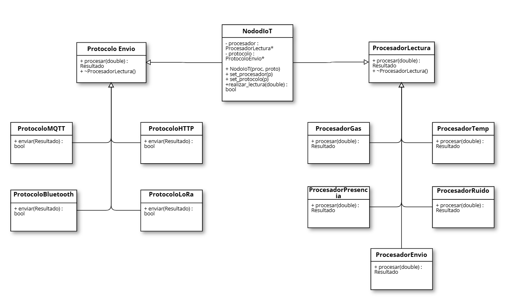

# Campus IoT — Sistema de Monitoreo con Patrón Estrategia

Sistema de monitoreo IoT en **C++17** que aplica el patrón de diseño **Estrategia (Strategy)**. Cada nodo del campus combina un algoritmo de procesamiento y un protocolo de comunicación, y ambos se pueden intercambiar mientras el programa corre, sin reiniciar el nodo.

Proyecto del curso *Implementación de Internet de las Cosas* — Tecnológico de Monterrey, Campus Puebla.

## Qué hace

- **4 procesadores de lectura:** Gas, Temperatura, Presencia y Ruido.
- **4 protocolos de envío (simulados):** MQTT, HTTP, Bluetooth y LoRa.
- **NodoIoT:** combina un procesador con un protocolo y permite cambiarlos en ejecución con `set_procesador()` y `set_protocolo()`.

## Diseño

| Rol del patrón | Clase |
| --- | --- |
| Estrategia | `ProcesadorLectura`, `ProtocoloEnvio` |
| Estrategias concretas | `ProcesadorGas`, `ProcesadorTemp`, `ProcesadorPresencia`, `ProcesadorRuido`, `ProtocoloMQTT`, `ProtocoloHTTP`, `ProtocoloBluetooth`, `ProtocoloLoRa` |
| Contexto | `NodoIoT` |

Principios aplicados:

- **Encapsular lo que varía:** el procesamiento y la comunicación viven en jerarquías separadas, así que agregar un sensor o un protocolo nuevo no obliga a modificar `NodoIoT`.
- **Programar contra interfaces:** `NodoIoT` solo conoce las clases abstractas y el polimorfismo decide qué implementación se ejecuta.
- **Composición sobre herencia:** el nodo *tiene* un procesador y un protocolo. Con 8 clases se cubren las 16 combinaciones posibles, en lugar de crear una clase por cada combinación.
- **Gestión de memoria con `unique_ptr`:** al reemplazar una estrategia, la anterior se libera automáticamente.

## Diagrama UML



## Cómo ejecutarlo

```bash
g++ -std=c++17 -Wall -Wextra main.cpp -o nodos
./nodos
```

En Windows con MinGW, ejecuta `nodos.exe`.

## Salida de ejemplo

```
--- Laboratorio ---
Estoy procesando gas
Envio por MQTT

--- Cambio dinamico del Aula: HTTP -> LoRa ---
Estoy procesando temperatura
Envio por LoRa
```

## Autor

**Rafael Rodríguez Botello Fierro** — Ingeniería en Sistemas Computacionales, Tec de Monterrey.

Basado en el ejemplo didáctico del simulador de patos del Dr. Juan Manuel González Calleros.
